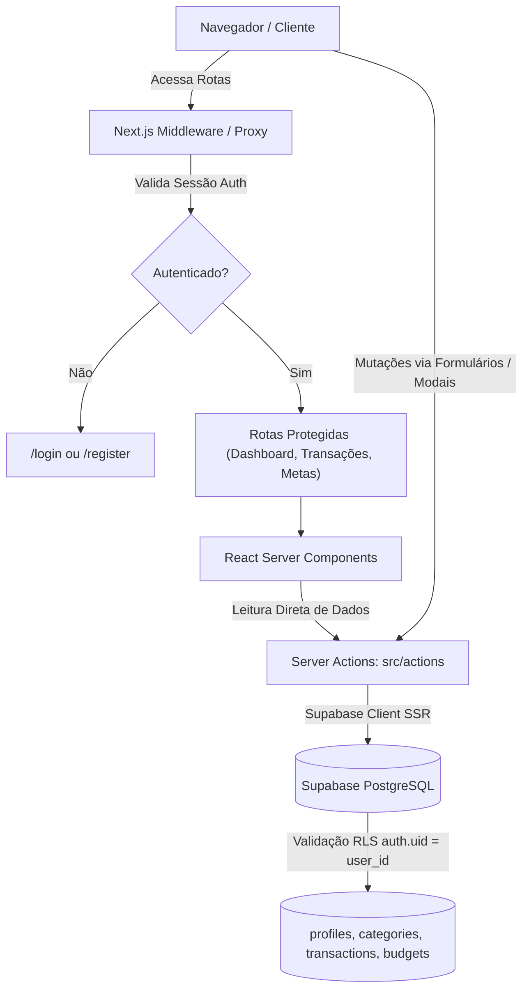
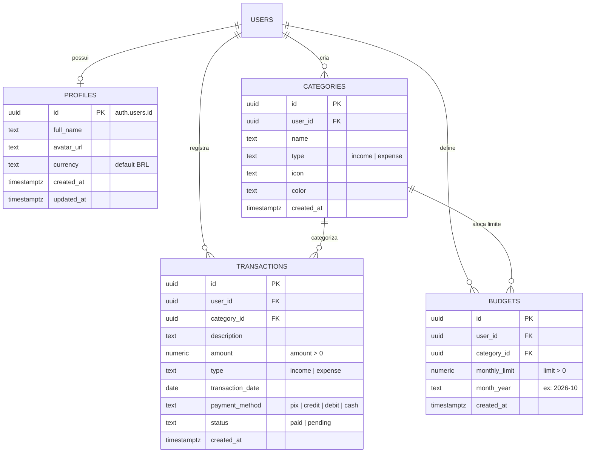

# 💰 App de Orçamento Pessoal

Sistema moderno e completo para gestão financeira pessoal e controle de orçamento, desenvolvido com foco em desempenho, segurança de dados a nível de banco (RLS) e experiência do usuário fluida e responsiva.

---

## 📌 Visão Geral do Sistema

O **App de Orçamento Pessoal** resolve a complexidade de acompanhamento financeiro diário através de:
- **Painel Consolidado de Indicadores (KPIs):** Receitas, despesas, saldo líquido e taxa de poupança em tempo real.
- **Gráficos e Visualização de Dados:** Fluxo de caixa com curvas de evolução financeira e distribuição percentual de gastos por categoria (via Recharts).
- **Gestão Integral de Transações:** Cadastro, visualização categorizada, status de liquidação (pago/pendente) e método de pagamento (PIX, cartão, etc.).
- **Planejamento & Metas Mensais (Budgets):** Definição de limites de gastos por categoria e mês de referência, permitindo controle preventivo de despesas.
- **Isolamento e Segurança Multi-tenant:** Autenticação robusta e isolamento total dos registros de cada usuário usando **Row Level Security (RLS)** diretamente no PostgreSQL do Supabase.

---

## 🛠️ Stack Tecnológica

| Camada | Tecnologia | Detalhes / Versão |
| :--- | :--- | :--- |
| **Frontend Framework** | [Next.js](https://nextjs.org/) | `v16.4.0` (App Router, Server Actions, Turbopack) |
| **Biblioteca de UI** | [React](https://react.dev/) | `v19.3.0` (Server Components & Hooks) |
| **Estilização** | [Tailwind CSS](https://tailwindcss.com/) | `v4.x` (Design responsivo, Glassmorphism, Dark mode) |
| **Ícones** | [Lucide React](https://lucide.dev/) | Ícones contextuais dinâmicos |
| **Gráficos** | [Recharts](https://recharts.org/) | `v3.10.1` (Área de fluxo de caixa e gráfico de pizza) |
| **BaaS / Persistência** | [Supabase](https://supabase.com/) | PostgreSQL, GoTrue Auth e `@supabase/ssr` |
| **Linguagem & Tipagem**| [TypeScript](https://www.typescriptlang.org/) | `v5.x` com tipagem estrita |
| **Qualidade & Linting** | [ESLint](https://eslint.org/) | `v9.x` com Next.js ESLint config |

---

## 🏗️ Arquitetura do Sistema

O projeto adota uma arquitetura em camadas orientada a **Server Components** e **Server Actions**, minimizando o payload enviado ao cliente e garantindo segurança no acesso à camada de persistência.

### Diagrama de Fluxo e Arquitetura de Componentes



---

## 🗄️ Modelo de Dados (Entidade-Relacionamento)

Todas as tabelas possuem suporte nativo a **Row Level Security (RLS)**, garantindo que nenhum usuário tenha acesso a dados de outros usuários mesmo em caso de falha na aplicação.



---

## 📂 Estrutura de Diretórios do Projeto

```text
App-orcamento-pessoal/
├── src/
│   ├── actions/                  # Server Actions (Mutação e consulta de dados no Supabase)
│   │   ├── auth.ts               # Login, registro e encerramento de sessão
│   │   ├── budgets.ts            # Gestão e acompanhamento de orçamentos mensais
│   │   ├── categories.ts         # CRUD de categorias de receita e despesa
│   │   └── transactions.ts       # Operações financeiras e agregações
│   ├── app/                      # Next.js App Router
│   │   ├── (auth)/               # Grupo de rotas públicas de autenticação
│   │   │   ├── login/page.tsx
│   │   │   └── register/page.tsx
│   │   ├── (dashboard)/          # Grupo de rotas protegidas da aplicação
│   │   │   ├── budgets/page.tsx       # Metas e orçamentos
│   │   │   ├── categories/page.tsx    # Gerenciador de categorias
│   │   │   ├── dashboard/page.tsx     # Visão consolidada (KPIs e Gráficos)
│   │   │   ├── transactions/page.tsx  # Histórico e tabela de transações
│   │   │   └── layout.tsx             # Shell de navegação (Sidebar e Topbar)
│   │   ├── favicon.ico
│   │   ├── globals.css           # Configurações globais e importações Tailwind v4
│   │   ├── layout.tsx            # Root layout
│   │   └── page.tsx              # Redirecionamento da raiz
│   ├── components/               # Componentes reutilizáveis
│   │   ├── dashboard/            # Cards de resumo, gráficos e tabelas recentes
│   │   ├── layout/               # Sidebar, Header e menus de usuário
│   │   └── transactions/         # Modais de formulário e filtros
│   ├── lib/                      # Utilitários e instâncias de clientes
│   │   ├── supabase/             # Clientes Supabase para Client e Server (SSR)
│   │   └── utils.ts              # Formatadores de moeda (BRL), datas e classes
│   ├── types/                    # Definições de interfaces e tipos do banco
│   └── middleware.ts             # Interceptador de autenticação de sessão
├── supabase-schema.sql           # Script DDL completo de migração do banco de dados
├── eslint.config.mjs             # Configuração do ESLint
├── next.config.ts                # Configuração do Next.js
├── package.json                  # Manifesto de dependências e scripts do Node.js
└── tsconfig.json                 # Configuração do compilador TypeScript
```

---

## 🚀 Guia de Execução

### 1. Pré-requisitos
- **Node.js**: Versão 20.x ou superior recomendada.
- **npm** ou gerenciador de pacotes equivalente.
- Uma conta ou projeto no [Supabase](https://supabase.com/).

### 2. Configuração das Variáveis de Ambiente
Crie um arquivo `.env.local` na raiz do projeto baseado no `.env.example`:

```env
NEXT_PUBLIC_SUPABASE_URL=https://seu-projeto.supabase.co
NEXT_PUBLIC_SUPABASE_ANON_KEY=sua-chave-anonima-supabase
```

### 3. Migração do Banco de Dados (Supabase)
1. Acesse o painel do seu projeto no Supabase.
2. Navegue até o menu **SQL Editor**.
3. Copie o conteúdo completo do arquivo [`supabase-schema.sql`](./supabase-schema.sql) e execute-o.
4. O script criará automaticamente as tabelas, triggers de perfil de usuário e as políticas de segurança RLS.

### 4. Instalação e Inicialização Local

```bash
# Instalar as dependências do projeto
npm install

# Iniciar o servidor em modo de desenvolvimento
npm run dev
```

Abra [http://localhost:3000](http://localhost:3000) no navegador para acessar o aplicativo.

### 5. Verificação de Qualidade e Build

```bash
# Checagem estrita de tipos TypeScript
npx tsc --noEmit

# Validação de regras e estilo com Linter
npm run lint

# Compilação de produção
npm run build
```

---

## 🔒 Segurança e Melhores Práticas Implementadas

- **Source-Level Security (RLS):** Toda query ou mutação é protegida diretamente pelo PostgreSQL via `auth.uid() = user_id`, impossibilitando vazamento acidental de dados entre contas.
- **Validação Server-Side:** Os inputs de valores monetários e tipos de transação são validados em tempo de execução nas Server Actions.
- **Triggers de Automação:** Criação transparente de perfis de usuário na inserção do `auth.users`.
- **Soft UI & Acessibilidade:** Design system com contraste calibrado, feedback visual para operações assíncronas e tipagem ponta a ponta.
